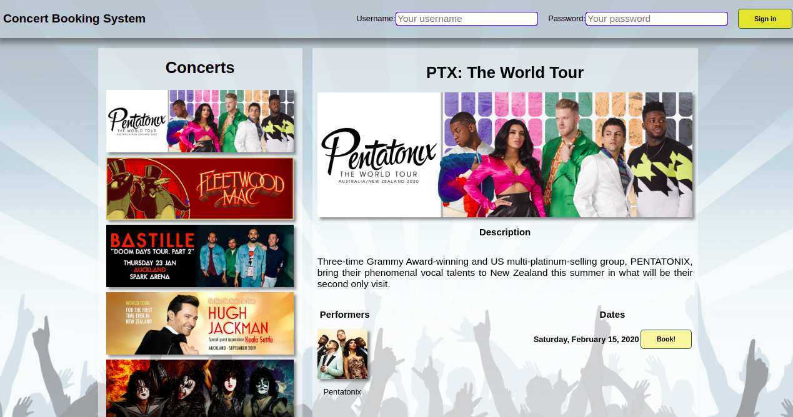
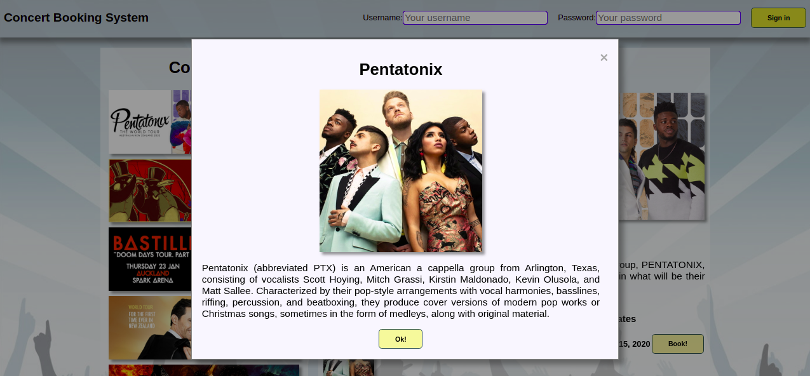
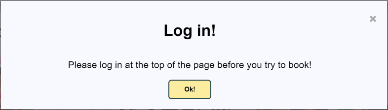
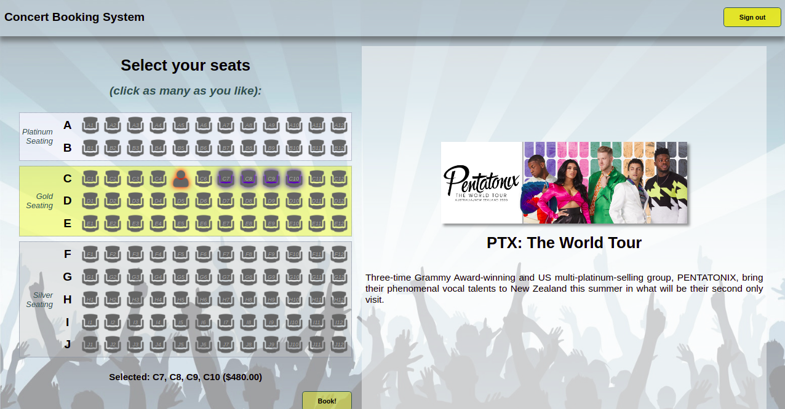
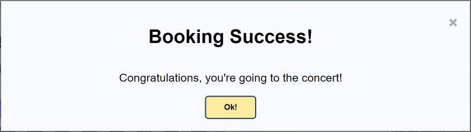

Project - A Concert Booking Service
==========

This project is a RESTful web service designed for managing concert ticket bookings. It supports seat reservations, performer browsing, user authentication, and subscription notifications for concerts that are about to sell out.

System description
----------
This system simulates a concert booking service for a small venue with 120 seats, divided into three price bands: Silver, Gold, and Platinum.

Key Business Requirements:

- 🎶 A concert may run on multiple dates, and each concert features at least one performer.

- 🎤 Performers may participate in multiple concerts.

- 👀 Users can browse concerts, performers, and seating with or without authentication.

- ✅ Authenticated users can:
  - 🎫 Make all-or-nothing reservations (no partial bookings allowed).
  - 🔒 View only their own bookings, not other users' bookings.
  - 🛎️ Subscribe to notifications for concerts that are nearly sold out.

- 🚫 Double-booking is strictly prohibited, ensuring that a seat can only be booked by one user per concert per date.

---
Features
----------
- 🎶 **Concert and Performer Information Browsing**  
  Retrieve details about available concerts, performers, and scheduled dates.

- 🎫 **Real-Time Seat Availability Checking**  
  Query available seats and pricing information for selected concerts and dates.

- 🔒 **Secure User Authentication**  
  Token-based session management allowing secure login and protected booking features.

- ✅ **Transactional All-or-Nothing Booking**  
  Ensures that either all requested seats are booked successfully or none at all, preventing partial reservations or double-booking.

- 🛎️ **Subscription-Based Notifications**  
  Users can subscribe to concert sellout notifications, keeping them informed when seats are running out.

---
## Project Structure

This project is organized as a **multi-module Maven project** named `project-concert`, consisting of three modules:

- `concert-client`:  
  A pre-built web application demonstrating the user interface.

- `concert-common`:  
  A shared module defining data transfer objects and types.

- `concert-service`:  
  Our core implementation, providing the backend web service and persistence logic.

The parent project's POM manages common dependencies and properties for all modules.

---

## System Architecture

The system follows a **tiered architecture**, where a browser-based web application communicates via HTTP with the backend web service.

---

## Client Module

A pre-built web application (HTML5, CSS, JavaScript, JSP, JSTL) demonstrating the user interface powered by our backend web service.  
We integrated and tested our service using this provided client without modifying its source code.

---

## Common Module

A shared module defining:
- 9 DTO classes for data transfer
- Jackson serializers for `LocalDateTime`
- Enumerations such as `Genre` and `BookingStatus`

---

## Service Module (our core implementation)

The service module contains:
- Domain model (Concert, Performer, ConcertDate, Booking, Seat, User)
- RESTful API endpoints using JAX-RS
- Persistence layer with JPA and Hibernate
- Concurrency control and subscription notification management
- Database utilities (e.g., ConcertUtils, TheatreLayout)
- Integration tests verifying system functionality

The module includes database initialization and logging configurations.  
Concert and performer data are preloaded using the `db-init.sql` script configured in `persistence.xml`.

All provided integration tests pass successfully using Maven's `verify` goal, confirming correct system behavior.

---
Appendix: The client webapp.
----------
The `concert-client` project contains a complete web application which is designed to communicate with your web service from both its server-side (Java) and client-side (JavaScript) code, to deliver its functionality.

#### App usage
Using the application, browsing to `/Concerts` or simply `/` (within the webapp's *context*) will present the "homepage" of the app, allowing the user to view concerts. On this page, users may scroll through the list of concerts on the left side of the page. Clicking on a concert will cause that concert's info to be displayed in the detail view.



On the detail view, users can see more information about the currently selected concert, as well as a list of performers and dates for that concert.

Clicking on a performer's image will display a modal dialog containing more information about that performer:



If the user hasn't logged in, then clicking on the "Book!" button next to one of a concert's dates will prompt the user to sign in:



If the user has already signed in, they will be redirected to the seat selection page for their selected concert and date. See `concert-service/src/main/resources/db-init.sql` for the data that the server is initialised with, including possible users and their passwords.



Here, users can see a visual seat map of the venue, along with an indicator of which seats have already been booked. Clicking unbooked seats will toggle a blue halo around that seat - an indicator that the seat has been selected for booking, as can be seen in the above screenshot. A list of selected seats - along with the total ticket price - can be seen below the seat map.

Once the user has made their selection, they can click the "Book!" button. Assuming they have "sufficient funds" (which will always be true for this test case), and that no other user has booked the same seats in the meantime, the user will be presented with a success dialog box:



Dismissing the dialog will redirect the user back to the concerts page, where they may continue to book tickets at other concerts / dates. (or more tickets for the same concert / date).

---
## Running the Project

The client and REST service are separate WAR applications. Deploy both to the same Tomcat instance so the client can reach the service.

### Prerequisites

- Java 11
- Maven 3
- Tomcat 9.x (the application uses the `javax.servlet` API; Tomcat 10+ uses the incompatible `jakarta.servlet` API)

### Install Java and Maven on macOS

The VS Code Java extension may download its own runtime for the editor. That does not necessarily install Java for your terminal or for Maven. Install a JDK and Maven with [Homebrew](https://brew.sh/):

```sh
brew install openjdk@11 maven
```

Make Java 11 available in the current terminal session:

```sh
export JAVA_HOME="$(brew --prefix openjdk@11)/libexec/openjdk.jdk/Contents/Home"
export PATH="$JAVA_HOME/bin:$PATH"
```

To keep this setting in new Terminal sessions, add those two `export` lines to `~/.zshrc` and open a new terminal. Then check that both tools are available:

```sh
java -version
mvn -version
```

The Java version should be 11. If `brew` is not found, install Homebrew first using the instructions on its website.

### Build

From the repository root, build both applications:

```sh
mvn clean package
```

Maven creates:

- `concert-client/target/concert-client-1.0.war`
- `concert-service/target/concert-service-1.0.war`

### Deploy and start Tomcat

1. Set `CATALINA_HOME` to your Tomcat 9 installation directory. For example:

   ```sh
   export CATALINA_HOME=/path/to/apache-tomcat-9
   ```

2. In `$CATALINA_HOME/conf/server.xml`, set the HTTP connector port to `10000` (change its `port="8080"` to `port="10000"`).

3. Copy the WARs into Tomcat's `webapps` directory with the context names expected by the client:

   ```sh
   cp concert-client/target/concert-client-1.0.war "$CATALINA_HOME/webapps/concert-webapp.war"
   cp concert-service/target/concert-service-1.0.war "$CATALINA_HOME/webapps/webservice.war"
   ```

4. Start Tomcat and leave this terminal open to see its logs:

   ```sh
   "$CATALINA_HOME/bin/catalina.sh" run
   ```

   To stop it, press `Ctrl+C` in that terminal.

5. Once Tomcat has deployed both applications, open <http://localhost:10000/concert-webapp/>. The service is available at <http://localhost:10000/webservice/services/concert-service>.

The service uses an embedded H2 database and initializes its schema and sample data when it starts. To run the automated tests instead, use `mvn verify` from the repository root.

---
## 🛠️ Technologies Used
- **Java** (JAX-RS, JPA/Hibernate)
- **Maven** (multi-module project structure)
- **HTML, CSS, JavaScript** (Client-side web application)
- **Tomcat 9.x** (for deployment)
- **Log4j** (for logging)
- **H2 Database** (in-memory persistence for demonstration)

---
## 🧑‍🤝‍🧑 Team Contribution

This project was completed as part of a team assignment during my Computer Science studies. Our team worked collaboratively on all aspects of the system, including:

- Domain model design and JPA mapping
- RESTful API implementation with JAX-RS
- Concurrency control strategy to prevent double-bookings
- Integration with a pre-built client-side web application

---
## 🧑‍💻 Personal Contribution
While the project was a team effort, I personally contributed to:
- Designing and implementing parts of the domain model (e.g., Concert, Performer, Seat Classes)
- Developing API endpoints to retrieve concert and performer information
- Participating in team planning, code reviews, and testing

---

## 📝 License
This project was originally developed as part of a university course assignment and has been adapted for public showcase. The front-end web application (concert-client) and the database were provided by the course instructors. Our team implemented the full backend logic in the concert-service module and integrated it with the provided client.

---
